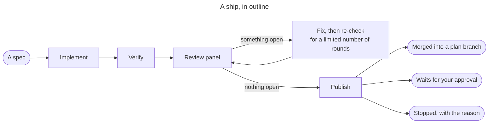
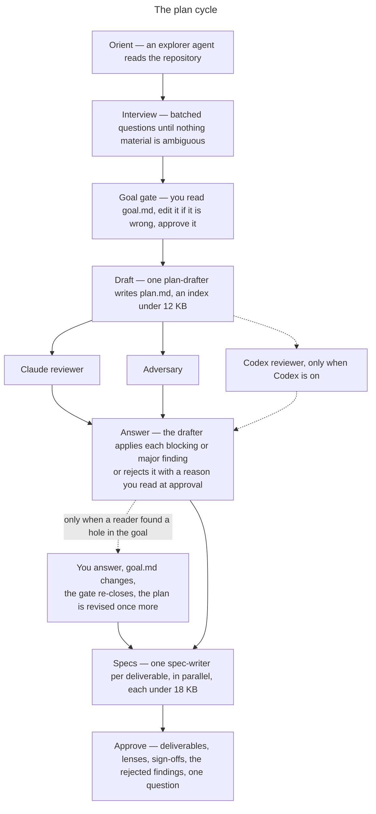

# tagteam

A Claude Code plugin that takes a change from a vague idea to merged pull
requests: multi-agent orchestration for agentic, spec-driven development, with an
adversarial AI code review on both the plan and the code. Codex, from OpenAI, can
join as an extra reviewing engine; it is optional.

## What it does for you

- **A vague goal becomes merged pull requests.** Describe what you want, however
  roughly. Tagteam interviews you until the outcome is concrete, writes a plan,
  breaks it into specs, then implements them one at a time, each in its own
  branch and each verified.
- **Every change is reviewed independently.** Lens reviewers, each calibrated to
  one concern such as correctness or security, read the diff separately, an
  adversary reads it fresh, and the findings gate the merge. The plan is reviewed
  the same way before any code is written. Give a lens its own model for a
  different view, or turn Codex on for a second engine from another vendor.
- **You stay in control.** Every decision you make is written to a file you can edit,
  and you approve what reaches your base branch.
- **Runs resume and show their cost.** A run that stops or crashes carries on
  from what is on disk. Each job thinks as hard as its work needs, a limit caps
  the fix rounds, and `/tagteam:status` shows where each spec is and what it cost.

It is for changes big enough to delegate and not so opaque that you cannot check
them.

## What a run looks like

You give `/tagteam:plan` a rough idea. Tagteam asks questions in plain language and
writes `goal.md`, which you read, edit and approve. It drafts, reviews and cuts the
plan into specs, then asks one last question with the deliverables and any finding
it declined. Approve, then run `/tagteam:ship` in a new session. It goes quiet while
Claude Code's workflow view shows each agent at work, and ends merged, stopped with
its reason, or asking you a question. A ship's review panel, as an illustration
with Codex on (the driver's wording, made-up lenses and models, the last line cut):

```text
Review panel on round 1: correctness, code-quality (sonnet at medium effort),
  security (opus at high effort) plus Codex (gpt-5.6-sol at high effort).
The correctness reviewer is in (1 of 4)
The security reviewer and the code-quality reviewer are in (3 of 4)
All 4 are in.
```



## Quick start

### Install

Always required: Claude Code 2.1.301 or newer with its Workflow tool (`/tagteam:ship`
and `/tagteam:plan` each run as a workflow and stop before creating anything when the
session has none), Git, and an authenticated GitHub CLI.

Required only with Codex on: the [Codex CLI](https://github.com/openai/codex)
0.153.0 or newer, refused before a plan or a ship starts when older: every call
goes through `codex app-server`, and 0.153.0 is the first release that reports the
model and effort a call ran at. `TAGTEAM_CODEX_BIN`, when set, names the Codex
binary to use and check instead of the one on your PATH.

Not yet verified: Windows, where ending a Codex process and everything it started
works differently. With Codex on, also Codex signed in with an API key or pointed
at a custom model provider rather than a ChatGPT account, and whether a `notify`
hook in your Codex configuration fires on tagteam's calls.

```bash
claude plugin marketplace add Smiley73/tagteam
claude plugin install tagteam@tagteam
```

There is no release to download: Claude Code installs plugins from the repository,
and `claude plugin update` picks up each version bump.

[CodeGraph](https://github.com/colbymchenry/codegraph) is optional, but every
agent can use it: one query returns a symbol's source with its callers, so a
reviewer sees a diff's blast radius and an implementer the code around its change,
without spending context on search. Without the index the agents read files; with
`codegraph` on your PATH, `/tagteam:configure` offers to build one.

### Use

```text
/tagteam:configure
/tagteam:plan Add account recovery with auditable security events
/tagteam:ship .tagteam/plans/add-account-recovery
/tagteam:status
```

Run `/tagteam:plan` and `/tagteam:ship` in **separate sessions**: the interview
loads repository material shipping does not need, and context is what runs out.

### Updating

A repository needs the plugin version its configuration requires **everywhere it
is run**: 0.8.2 if it calibrates its own lenses, and for a configuration at
version 9, 0.9.0; 10, 0.10.6; 11, 0.13.0; 12, 0.14.0; 13, which added the Codex
setting, 0.14.8. Commit a brief and the roster entry that names it together.

Which refresh applies depends on which version moved. If the package version in
`.claude-plugin/plugin.json` and `.claude-plugin/marketplace.json` was raised,
update in place:

```bash
claude plugin marketplace update tagteam
claude plugin update tagteam@tagteam
```

For every other change `update` reports nothing to do: run
`claude plugin uninstall tagteam@tagteam` and install again with the
[Install](#install) commands. Restart the session either way.

## How it works

### Planning



1. **Interview.** Batched questions, informed by reading the repository first,
   multiple choice where there are real options, about the outcome and in plain
   language, so answering never means opening a file. Product and interface
   decisions are yours; with no preference, tagteam decides and records why.
2. **Goal gate.** You read the `goal.md` the interview writes and edit it if it is
   wrong; everything downstream binds to the file, not the conversation.
3. **Draft and review.** One drafter writes a plan. A Claude reviewer and an
   adversary read it at the same time, and with Codex on, so does a Codex
   reviewer. The drafter answers every blocking and major finding by id: it
   applies the ones it accepts and writes one line on why for each it rejects,
   which you read at approval. There is no second review round: across the plans
   reviewed by three readers, none ever closed with nothing blocking or major.
4. **Specs.** One file per deliverable, written in parallel, each self-contained
   for its implementer; a plan and a spec each have a size the run enforces.
5. **Approve.** Deliverables in dependency order, the lenses each will get, the
   findings the drafter declined and why, and one question. Anything the
   repository's conventions say to ask about first, such as a new dependency or
   top-level directory, is listed as that spec's sign-off and approved with the
   plan, so shipping does not stop to ask. So are the `.github/workflows/` files a
   spec will change: it may then change exactly those and merge into the plan
   branch without stopping.

The session you started in runs the interview and the goal gate. From the
approved goal to validated specs, one workflow run, `tagteam:plan-specs`, does the
draft, review, answer and spec writing. It ends with validated specs, a stop and
its reason, or a question for you, such as a finding against the goal itself; a
new run carries on from your answer, reviewing nothing again.

### Shipping

Each spec runs the outline above. The review panel is the spec's lens reviewers,
plus Codex when it is on, and an adversary reads the code fresh after a fix. Ship
a plan as one, on a branch of its own, and its specs merge there without waiting
once their checks are clean, and you judge the plan as one change in its own pull
request; otherwise each spec waits for your approval before it merges into the
base. [docs/shipping.md](docs/shipping.md) has every step, what stops a spec and
what a person can approve past.

What you can rely on: reviewers cannot write, and Codex, when on, only reviews. A
review binds to one commit, and a merge happens at exactly that commit. Nothing
reaches the base without a person; a plan branch reaches it only through the pull
request you say Merge to. [docs/architecture.md](docs/architecture.md) has how each
is enforced and how a Codex call is sandboxed and recorded.

## Configuration

`/tagteam:configure` writes `.tagteam/config.json`, which you commit, and
[skills/tagteam/SKILL.md](skills/tagteam/SKILL.md) has every key. The settings a
newcomer would change:

| Setting | What it does |
|---|---|
| `useCodex` | Codex on or off, asked first as whether Codex should review as a second reader, alongside Claude. Run `/tagteam:configure --reconfigure` to change it. With it off, nothing checks for or calls Codex and configure asks no Codex model or effort. [How it works](#how-it-works) has what a review consists of either way |
| `models`, `effort` | The `lead` and `worker` models, and an effort for each job: the implementer, fixer and adversary at `high` by default, lens reviewers at `medium`, and re-checks, which only say whether one fix landed, at `low`. `codex` entries apply only with Codex on |
| `lensSettings` | A lens's own `model` and `effort` in the review panel, such as `"security": { "model": "opus", "effort": "high" }`. It applies to lens reviewers only, falls back to `models` and `effort`, shows in the panel line and costs that lens on every round |
| `reviewers.roster`, `reviewers.default` | The lenses a plan may assign and those every spec gets. Every default lens is one more reader on every round |
| `planBranch`, `carry`, `mergeWithOpenFindings` | Whether a plan's specs merge into a branch of their own without waiting, and whether a spec whose fix rounds ran out may merge with its open findings disclosed (`carry`: findings that may be carried; `mergeWithOpenFindings`: more). See [Shipping a plan as one](docs/shipping.md#shipping-a-plan-as-one) |
| `limits`, `ciWaitSec`, `ciStartWaitSec` | Fix rounds, CI repairs, carried findings and follow-up units, and how long to wait for checks |
| `versionFiles` | The lines that carry your version, so a plan's one increase is made for you |

**Lenses.** The plugin ships ten briefs: correctness, resilience, security,
architecture, code-quality, experience, consistency, cost, economy and `docs`,
which reads documentation changes for whether they are true, written once and
concise. `docs` is in the example roster and no default; a plan assigns it to specs
that change documentation. A repository adds its own by committing
`.tagteam/lenses/<lens>.md`, so a project whose correctness lives in tax years or
dosages gets a `financial` or a `math` reviewer the plugin could never have written.
A brief named after a shipped one replaces it; a rostered lens with no brief is refused.

## Reference

- [skills/tagteam/SKILL.md](skills/tagteam/SKILL.md) — every configuration key, the
  artifact layout, the gates and recovery, and the Codex bridge.
- [examples/config.json](examples/config.json) — a complete configuration.
- [docs/shipping.md](docs/shipping.md) — every step of a ship and what stops it.
- [docs/architecture.md](docs/architecture.md) — how tagteam is built and kept safe.
- [docs/confirm-step-answer-check.md](docs/confirm-step-answer-check.md) — confirming once, after an update, that the step answer check runs.
- [CONTRIBUTING.md](CONTRIBUTING.md) — working on tagteam, from setup to a pull request.
- [CHANGELOG.md](CHANGELOG.md) — what changed in each version.

## License

MIT. See [LICENSE](LICENSE).
