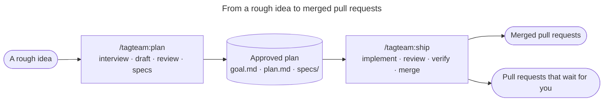
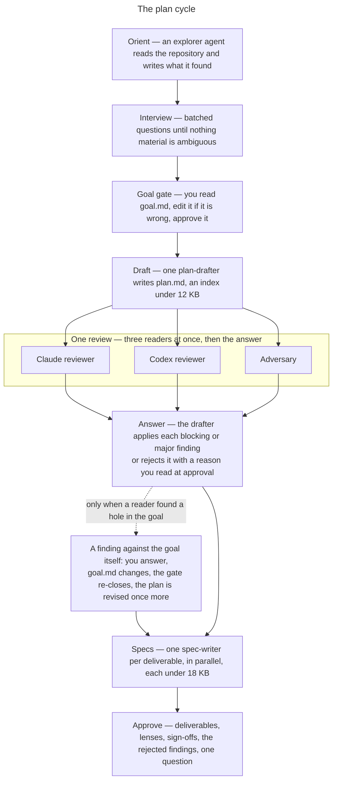
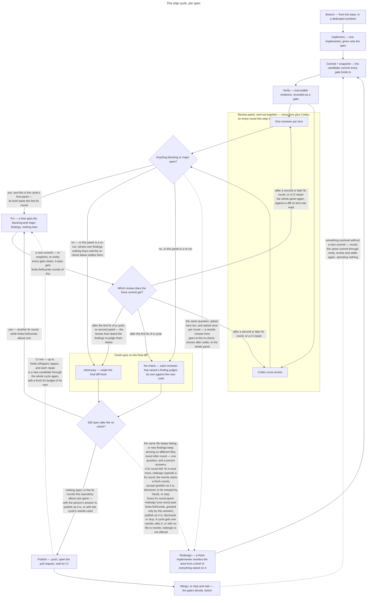
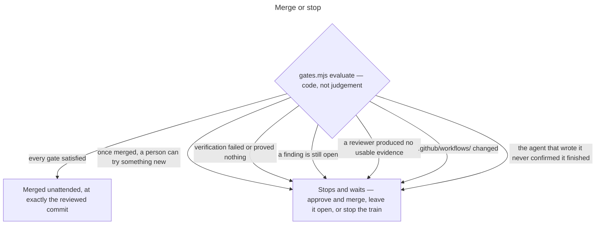

# tagteam

A Claude Code plugin that takes a change from a vague idea to merged pull
requests, using Claude and Codex together. It is multi-agent orchestration for
agentic, spec-driven development: autonomous AI agents from Anthropic and
OpenAI plan the work, implement it, and cross-review every diff, with an
adversarial AI code review on both the plan and the code.

You describe what you want, however roughly. Tagteam interviews you until the
outcome is concrete, writes a plan, has it read once by three independent
reviewers whose findings the drafter answers in writing, and breaks it into spec
files. Then it implements those specs one at a time — each in its own branch,
each reviewed by a cross-engine panel, each verified — and merges the ones that
need no judgement from you. The ones that do stop and wait.

It is for changes big enough that you want them delegated and not so opaque that
you cannot check them. Every decision you make is written to a file you can edit.
Every merge happens at the exact commit that was reviewed.



## Install

Requires Claude Code 2.1.301 or newer, Git, the
[Codex CLI](https://github.com/openai/codex) 0.153.0 or newer, and an
authenticated GitHub CLI. An older Codex is refused before a plan or a ship
starts: every Codex call goes through `codex app-server`, and 0.153.0 is the
first release that reports the model and effort a call actually ran at.
`TAGTEAM_CODEX_BIN`, when set, names the Codex binary to use instead of the one
on your PATH, and that is the one checked.

Not yet verified: Windows (where ending a Codex process and everything it
started works differently), Codex signed in with an API key or pointed at a
custom model provider rather than a ChatGPT account, and whether a `notify` hook
in your own Codex configuration fires on tagteam's calls.

```bash
claude plugin marketplace add Smiley73/tagteam
claude plugin install tagteam@tagteam
```

There is no release to download — Claude Code installs plugins from the
repository itself, and `claude plugin update` picks up each version bump. From
a local checkout, `claude plugin marketplace add` the checkout's absolute path
instead, or run Claude Code with `--plugin-dir /absolute/path/to/tagteam`.

[CodeGraph](https://github.com/colbymchenry/codegraph) is optional, but every
agent tagteam dispatches can use it: one query returns a symbol's source
together with its callers, so a reviewer sees a diff's blast radius — and an
implementer the code around its change — without spending context on search.
Without the index the agents read files instead; with `codegraph` on your
PATH, `/tagteam:configure` offers to build one.

## Use

```text
/tagteam:configure
/tagteam:plan Add account recovery with auditable security events
/tagteam:ship .tagteam/plans/add-account-recovery
/tagteam:status
```

Run `/tagteam:plan` and `/tagteam:ship` in **separate sessions**. The interview
loads repository material that shipping does not need, and context is the thing
that runs out.

### Planning



1. **Interview.** Questions in batches, informed by reading the repository first.
   Multiple choice where there are real options. Questions are about the outcome
   and asked in plain language — the symbols, paths and line numbers behind them
   stay in the notes, so answering never means opening a file. Product and
   interface decisions are always yours; when you have no preference, tagteam
   decides and records the reasoning and what it rejected.
2. **Goal gate.** The interview writes `goal.md`. You read it, edit it if it is
   wrong, and everything downstream binds to the file rather than to the
   conversation.
3. **Draft and review.** One drafter writes a plan. A Claude reviewer, a Codex
   reviewer, and an adversary read it at the same time. The drafter then answers
   every blocking and major finding by id: it applies the ones it accepts and
   writes one line on why for each one it rejects, and you read the rejections
   when you approve. There is no second review round. Across every plan this
   plugin had reviewed, no round of three readers ever closed with nothing
   blocking or major, so a loop that ran until one did ran to its budget every
   time, finding new things in each revision.
4. **Specs.** One file per deliverable, written in parallel, each self-contained
   for the implementer that will receive it. A plan is an index and a spec says
   what the repository cannot; both have a size the run enforces.
5. **Approve.** Deliverables in dependency order, the lenses each will get, the
   findings the drafter declined and why, and one question. Anything a spec
   needs that the repository's conventions say to ask about first — a new
   dependency, a new top-level directory — is listed there as that spec's
   sign-off and approved with the plan, so shipping does not stop to ask (a change
   to the CI workflows still does).

### Shipping

Per spec, in dependency order: branch, implement, verify, review, fix, re-check,
publish, merge — with the fix and the review repeating for as many rounds as you
allow. A driver script sequences every step and prints every dispatch; the
orchestrating agent runs it, dispatches what it prints, and talks to you.



Each lens is calibrated by a brief: the plugin ships eight, and a repository
adds its own by committing `.tagteam/lenses/<lens>.md`. That is how a project
whose correctness lives in tax years or dosages gets a `financial` or a `math`
reviewer the plugin could never have written, and a brief named after one the
plugin ships replaces it. A rostered lens with a brief in neither place is
refused rather than reviewed on improvisation.

The review panel is the spec's lenses plus a Codex cross-review, sent out
together to run at the same time. As each one reports you see one line saying
who is in and how many of the panel have reported ("The correctness reviewer is
in (1 of 3)"), and the review is judged once, when the last one is in; a reviewer
still working is never mistaken for one that failed. Codex is told which
lenses are reading beside it and hunts for what falls between them. After a fix
round, each reviewer that raised a finding re-checks its own findings against
the new code, and an adversary reads the fixed diff fresh. Anything still open
starts another round, for as many rounds as `limits.fixRounds` allows; when they
run out the pull request stops with the findings on it and says so. The one way
past that limit without raising it is a person's answer to the question below,
once per cycle.

The rounds also watch for two patterns no single round can see. One is the same
file drawing a new blocking or major finding three or more rounds running, each
repair opening the next case. The other is new blocking or major findings
arriving in each of the last three rounds of the cycle, on a different file each
time — or on the pull request, or on no file at all. A spec that is converging
never shows the second: a quiet round breaks the run. When either happens the
run stops to ask, and when both do it asks once, naming each file once. While a
fix round is still left there are four answers: fix it once more; redesign — a
fresh implementer rewrites the files from a brief of everything raised on them
this cycle, spending a fix round, and the rewrite starts a fresh count for each
file it changes; accept — publish it as it is with what is open disclosed, to be
merged by hand; or stop. A redesign covers the files both patterns name; when
the findings are only about the pull request or name no file, there is nothing
to rewrite, and redesign is not offered.

When every fix round is spent, the run asks before it publishes, with three
answers: redesign, which takes one more round past `limits.fixRounds` that only
this answer grants; publish it as it is, with what is open disclosed, to be
merged by hand; or stop. The question is put once per round: answered at the
review, the re-check that follows does not ask again unless it raises something
the person was not shown.

A cycle gets one rewrite, whether it is chosen with rounds left or at the cap,
and whether or not it changes anything. After it, the question no longer offers
redesign, and once the fix rounds are spent the run publishes with what is open
disclosed without asking, and says so. A rewrite at the cap that still fails is
published the same way, for a person to merge by hand. A CI repair starts a new
cycle, and the new cycle gets a rewrite of its own.

Each job thinks as hard as its work needs: the implementer, the fixer and the
adversary at high effort by default, lens reviewers at medium, and re-checks —
which only have to say whether one fix landed — at low. Every one of those is a
setting in `.tagteam/config.json`.

A pull request merges unattended unless: the spec is marked as the one after
which a person can try something new, so it waits for manual testing,
verification failed or CI proved nothing, a finding is still open, **a reviewer
produced no usable evidence**, `.github/workflows/` changed, or the agent that
wrote it never confirmed it finished what it was given.

That fourth one matters more than it sounds: an absent or malformed findings file
yields an empty finding set, and an empty finding set otherwise reads as a clean
review.

A person can approve past some of those stops and not others. A spec waiting
for manual testing, a workflow change, and an unconfirmed account are theirs to
accept; a failed
verification, an open finding, and a reviewer that produced no usable evidence
are cleared only by new evidence, and `finish` offers approval only when it
would count.



### Shipping a plan as one

By default every spec of a plan merges into the base branch as soon as its own
gates allow, so a plan half-shipped is half on `main`. Turn on `planBranch` in
`/tagteam:configure` and a plan of two or more specs ships as one instead:

- Its specs collect on a branch of their own, `plan/<slug>`. Each is still its
  own pull request, into that branch, reviewed and gated exactly as above, and
  `autoMerge` still decides those merges. Nothing from the plan reaches the base
  until the end.
- Before each spec starts, the base is tried against the plan's branch. When it
  no longer merges cleanly, an agent resolves that one merge, the review panel
  reads what it resolved, and the ship pushes the merge commit itself. The plan's
  branch is never rebased.
- After the last spec, the whole plan is checked as one change: every verify
  command, and one reviewer reading how the specs fit together. What it finds is
  fixed as one more small pull request into the plan's branch.
- Then the plan reaches the base through one final pull request, merged with a
  merge commit at exactly the commit that was checked, so each spec keeps its own
  commit in the base's history. **A person confirms that merge every time**,
  whatever `autoMerge` says: you are shown what lands, the plan's checks, the
  check against the base as it is now, and what the plan lands as, and you
  answer Merge, Leave open, or Stop. Merge is offered only when nothing shown
  fails. Leaving it open ends the run, and `/tagteam:ship` on the plan brings the
  same question back.

The repository has to allow merge commits into the base, and its checks have to
run on pull requests into the plan's branch; the ship says so plainly when
either is not the case, and changing it is a repository setting for you.

**The version.** List the lines that carry your version in `versionFiles` —
configure proposes them — and a plan of two or more specs carries exactly one
increase of them: a patch, unless the plan document says `Version increase:
minor` under its title. The ship makes it itself, as the last commit on the
plan's branch, once the whole plan is checked, from the base's version at that
moment, and the question names it ("lands as 0.10.6 → 0.10.7"). A spec that
changes a version line on the plan's branch stops before it is published, since
the increase is the ship's. If another plan lands first, the ship notices that
the base's version moved — it compares the numbers, because two plans raising
the same number merge without any conflict — merges the base in, and makes the
increase again over it. So two plans of two or more specs that land one after
the other never land the same number. A plan of one spec goes straight to the
base, as it always did, and keeps your repository's own habit for its version:
it is outside that guarantee and can collide with a plan landing beside it. The
guarantee is one checkout's: two people confirming two plans from two machines
within seconds are guarded only by your repository's own rule that a branch be
up to date before it merges, a setting you change on GitHub. An empty
`versionFiles` makes no increase at all.

After each spec, `/tagteam:status` can say what it cost: tagteam reads the
session transcripts Claude Code keeps and reports the spend as input-token
equivalents, split between the orchestrating agent and the agents it dispatched.
A Codex line follows it with what that spec's own Codex calls spent, in plain
tokens — input, how much of it was cached, and output — kept apart from the
Claude figure because Codex is paid from a different bill, and still there when
the Claude figure could not be worked out. A Codex call that fails keeps its
spend on record too.
Each spec, and each plan at approval, also names any agent that ran at a
different effort or model than it was sent at, or whose run could not be
confirmed, as a report that never holds anything up.

## How it is built

The orchestrator is the main Claude Code agent following the command files. In a
ship it runs `scripts/ship.mjs` once per step; the driver runs git, Codex and
the other scripts, decides the round, the route and every model and effort, and
prints the agents to dispatch with their prompts written out. The orchestrator
sends them out together and tells the driver as each one reports, one short line
per agent, and the driver judges their work only once all are in. The
orchestrator relays what happened in plain English, writes the pull request
body, and asks the questions only a person can answer.
Subagents write their own outputs; scripts read them. Nothing large is ever
moved between steps by passing it through a model.

Decisions that are silent when wrong are code, not prose: which commit gets
merged, whether the gates are satisfied, how CI checks classify, which round a
commit belongs to, and which settings a dispatch runs at. What is left in the
command files is what a person has to be told and asked.

State is files on disk. There are no fingerprints, reuse ledgers, or invocation
records — a re-run looks at what exists and continues from the first thing that
does not.

## Safety

- Reviewers have no write or shell tools. Codex runs `read-only` and only ever
  reviews.
- Codex runs through `codex app-server`: one throwaway thread per call, a
  read-only sandbox with the network closed, approvals never, and the answer
  held to a JSON schema. MCP is unsupported because its tool contract cannot
  enforce a response schema.
- What Codex reports it ran as is recorded beside every answer: the model, the
  effort, the sandbox and network, the approval policy, the Codex version, and
  the instruction files it read. Those instruction files — your own global
  `AGENTS.md` and the repository's — keep steering Codex by design; they are
  recorded, not switched off. An effort other than the one asked for fails the
  call; anything else that differs is said once and blocks nothing; anything
  Codex did not report is asked about.
- Codex still writes its own short-lived files under its home directory while a
  call runs, and tagteam deletes nothing there.
- Every gate binds to one commit; a new commit clears all of them, and every fix
  round makes one.
- Merges use `--match-head-commit`, so what merges is the commit that was
  reviewed. When the base branch has moved since the review, the merge is not
  taken on trust: the reviewed change is checked against the base as it now
  stands — it has to merge cleanly, land as the same change, and pass this
  repository's verify commands there — and only a check that passes lets the
  reviewed commit merge. Nothing is ever rebased, amended or re-committed; a
  check that does not pass, and any other merge failure, stops and reports.
- A commit is only made through `git add -A && guard-staged && git commit`, which
  refuses to commit a copied ignored file.
- A spec after which a person can try something new waits for them to try it
  before it merges. The plan marks which specs those are; the person approving
  it sees the marking and can change it in each spec's front matter until that
  spec begins shipping.

## Reference

[skills/tagteam/SKILL.md](skills/tagteam/SKILL.md) — configuration, artifact
layout, dispatching, the Codex bridge, the Git protocol, the gates and recovery.
[examples/config.json](examples/config.json) — a complete configuration.

## Development

```bash
npm test
```

Node built-ins only, no dependencies.

After updating Codex, check that tagteam still fits it:

```bash
npm run probe:codex                  # both halves
npm run probe:codex -- --free-only   # the free half alone
```

The free half asks the installed Codex to describe its own protocol and checks
that everything tagteam sends to Codex and reads back is still in it. It costs
nothing and takes about a second. The paid half runs only when the free half
passes. It makes one real Codex call the way a review does and checks that Codex
answered, reported how it ran, answered in the requested format, reported what
the call spent, and left no Codex process or session behind. That call costs
about 19K input tokens and a few seconds at the default `low` effort. It uses
the model `models.codex` names in `.tagteam/config.json`; `--model` and
`--effort` choose others, and `--effort max` checks the most expensive setting.
Either half names the first thing that broke. The probe exits 1 when the
installed Codex no longer fits tagteam, and 2 when it could not check at all:
Codex is missing or too old, its configuration is broken, a usage limit was
hit, or the model is not available to the account. It never runs under
`npm test`.

The probe has only been run on macOS with a ChatGPT sign-in and OpenAI's own
models. It says so when Codex reports a different platform or model provider,
and it has not been tried with an API-key sign-in. Whether a `notify` hook in
your Codex configuration fires on the paid call has not been checked either.

The diagrams in this file are Mermaid source. GitHub renders them, and changing
one is a text edit here, with no image files to regenerate.

A repository that calibrates its own lenses needs plugin 0.8.2 or newer
**everywhere it is run**, one configured at version 9 needs 0.9.0 or newer, and
one configured at version 10 needs 0.10.6 or newer.
Commit a brief and the roster entry that names it in the same commit, and
refresh the plugin below.

This repository self-hosts tagteam. Unless you start Claude Code with
`--plugin-dir`, it runs the installed plugin snapshot rather than this working
tree: `.tagteam/config.json` is read live from the repository, but the scripts
and command files reading it belong to the snapshot. A change to a plugin file
does nothing here until the snapshot is refreshed. `/tagteam:status`,
`/tagteam:plan` and `/tagteam:ship` each say which snapshot is running them
and, in a checkout of the plugin itself, name the files that actually execute
whose installed copy differs from the working tree.

Which refresh applies depends on which version moved. If the package version in
`.claude-plugin/plugin.json` and `.claude-plugin/marketplace.json` was raised,
update in place:

```bash
claude plugin marketplace update tagteam
claude plugin update tagteam@tagteam
```

For every other change, `update` reports there is nothing to do. Run
`claude plugin uninstall tagteam@tagteam` and install again with the
[Install](#install) command. Restart the session either way.

## License

MIT. See [LICENSE](LICENSE).
