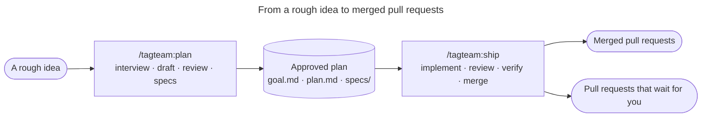
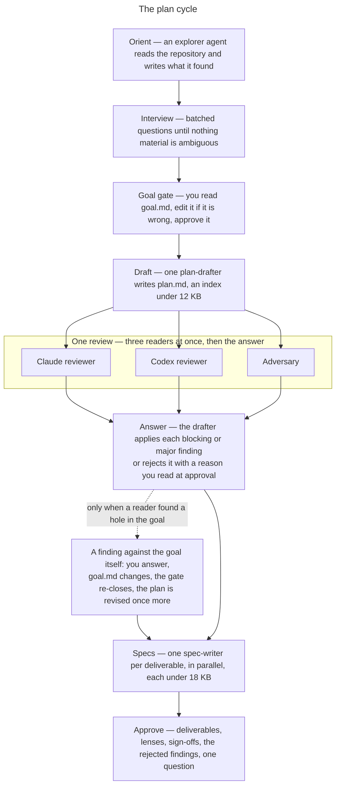

# tagteam

A Claude Code plugin that takes a change from a vague idea to merged pull
requests, using Claude and Codex together. It is multi-agent orchestration for
agentic, spec-driven development: autonomous AI agents from Anthropic and
OpenAI plan the work, implement it, and cross-review every diff, with an
adversarial AI code review on both the plan and the code.

You describe what you want, however roughly. Tagteam interviews you until the
outcome is concrete, writes a plan, has it read once by three independent
reviewers whose findings the drafter answers in writing, and breaks it into spec
files. Then it implements those specs one at a time — each in its own branch,
each reviewed by a cross-engine panel, each verified. Nothing reaches your base
branch without your approval or your Merge. Ship a plan as one, on a branch of
its own, and its specs merge there without waiting once their checks are clean,
and you judge the plan as one change in its own pull request; otherwise each
spec waits for your approval before it merges into the base.

It is for changes big enough that you want them delegated and not so opaque that
you cannot check them. Every decision you make is written to a file you can edit.
Every merge happens at the exact commit that was reviewed.



## Install

Requires Claude Code 2.1.301 or newer with its Workflow tool (`/tagteam:ship`
runs each spec, and `/tagteam:plan` its draft, review and specs, as a Claude Code
workflow, and each stops before creating anything when the session has no such
tool), Git, the
[Codex CLI](https://github.com/openai/codex) 0.153.0 or newer, and an
authenticated GitHub CLI. An older Codex is refused before a plan or a ship
starts: every Codex call goes through `codex app-server`, and 0.153.0 is the
first release that reports the model and effort a call actually ran at.
`TAGTEAM_CODEX_BIN`, when set, names the Codex binary to use instead of the one
on your PATH, and that is the one checked.

Not yet verified: Windows (where ending a Codex process and everything it
started works differently), Codex signed in with an API key or pointed at a
custom model provider rather than a ChatGPT account, and whether a `notify` hook
in your own Codex configuration fires on tagteam's calls.

```bash
claude plugin marketplace add Smiley73/tagteam
claude plugin install tagteam@tagteam
```

There is no release to download — Claude Code installs plugins from the
repository itself, and `claude plugin update` picks up each version bump.

[CodeGraph](https://github.com/colbymchenry/codegraph) is optional, but every
agent tagteam dispatches can use it: one query returns a symbol's source
together with its callers, so a reviewer sees a diff's blast radius — and an
implementer the code around its change — without spending context on search.
Without the index the agents read files instead; with `codegraph` on your
PATH, `/tagteam:configure` offers to build one.

## Use

```text
/tagteam:configure
/tagteam:plan Add account recovery with auditable security events
/tagteam:ship .tagteam/plans/add-account-recovery
/tagteam:status
```

Run `/tagteam:plan` and `/tagteam:ship` in **separate sessions**. The interview
loads repository material that shipping does not need, and context is the thing
that runs out.

### Planning



1. **Interview.** Questions in batches, informed by reading the repository first.
   Multiple choice where there are real options. Questions are about the outcome
   and asked in plain language — the symbols, paths and line numbers behind them
   stay in the notes, so answering never means opening a file. Product and
   interface decisions are always yours; when you have no preference, tagteam
   decides and records the reasoning and what it rejected.
2. **Goal gate.** The interview writes `goal.md`. You read it, edit it if it is
   wrong, and everything downstream binds to the file rather than to the
   conversation.
3. **Draft and review.** One drafter writes a plan. A Claude reviewer, a Codex
   reviewer, and an adversary read it at the same time. The drafter then answers
   every blocking and major finding by id: it applies the ones it accepts and
   writes one line on why for each one it rejects, and you read the rejections
   when you approve. There is no second review round. Across every plan this
   plugin had reviewed, no round of three readers ever closed with nothing
   blocking or major, so a loop that ran until one did ran to its budget every
   time, finding new things in each revision.
4. **Specs.** One file per deliverable, written in parallel, each self-contained
   for the implementer that will receive it. A plan is an index and a spec says
   what the repository cannot; both have a size the run enforces.
5. **Approve.** Deliverables in dependency order, the lenses each will get, the
   findings the drafter declined and why, and one question. Anything a spec
   needs that the repository's conventions say to ask about first — a new
   dependency, a new top-level directory — is listed there as that spec's
   sign-off and approved with the plan, so shipping does not stop to ask. The
   `.github/workflows/` files a spec will change are listed per spec, one per
   line, and approved the same way: that spec may then change exactly those
   files and merge into the plan branch without stopping.

The session you started in runs the interview and the goal gate itself. From the
approved goal to specs that validate, one Claude Code workflow run,
`tagteam:plan-specs`, runs the draft, the three-reader review, the drafter's answer
and the spec writers, and the session goes quiet until it ends. Progress is in
Claude Code's own workflow view, each agent under its name and every line the
driver says as the driver wrote it. A run ends with the specs validated, with a
stop and its reason, or with a question for you, such as a finding against the
goal itself; you answer in the session and a new run carries on from your answer,
without reviewing anything again.

### Shipping


Each spec runs in order: implement, verify, a review panel, fixes and re-checks
for a limited number of rounds, then publish. A spec merges unattended into a plan
branch, or waits for your approval when it goes straight to the base. A run ends
merged, stopped or asking you a question. [docs/shipping.md](docs/shipping.md)
has every step, what stops a spec and what a person can approve past.

Each lens is calibrated by a brief: the plugin ships nine, and a repository
adds its own by committing `.tagteam/lenses/<lens>.md`. That is how a project
whose correctness lives in tax years or dosages gets a `financial` or a `math`
reviewer the plugin could never have written, and a brief named after one the
plugin ships replaces it. A rostered lens with a brief in neither place is
refused rather than reviewed on improvisation.

Each job thinks as hard as its work needs: the implementer, the fixer and the
adversary at high effort by default, lens reviewers at medium, and re-checks —
which only have to say whether one fix landed — at low. Every one of those is a
setting in `.tagteam/config.json`.

## Reference

[skills/tagteam/SKILL.md](skills/tagteam/SKILL.md) — configuration, artifact
layout, dispatching, the Codex bridge, the Git protocol, the gates and recovery.
[examples/config.json](examples/config.json) — a complete configuration.
[docs/shipping.md](docs/shipping.md) — the detail of a ship: the review panel, the
fix rounds, what stops a spec and shipping a plan as one.
[docs/architecture.md](docs/architecture.md) — how tagteam is built, and what
keeps a run safe.
[CONTRIBUTING.md](CONTRIBUTING.md) — working on tagteam: setup, tests, the Codex
probe and opening a pull request.

## Updating

A repository that calibrates its own lenses needs plugin 0.8.2 or newer
**everywhere it is run**, one configured at version 9 needs 0.9.0 or newer, one
configured at version 10 needs 0.10.6 or newer, and one configured at version 11
needs 0.13.0 or newer, and one configured at version 12 needs 0.14.0 or newer.
Commit a brief and the roster entry that names it in the same commit, and
refresh the plugin below.

Which refresh applies depends on which version moved. If the package version in
`.claude-plugin/plugin.json` and `.claude-plugin/marketplace.json` was raised,
update in place:

```bash
claude plugin marketplace update tagteam
claude plugin update tagteam@tagteam
```

For every other change, `update` reports there is nothing to do. Run
`claude plugin uninstall tagteam@tagteam` and install again with the
[Install](#install) command. Restart the session either way.

## License

MIT. See [LICENSE](LICENSE).
