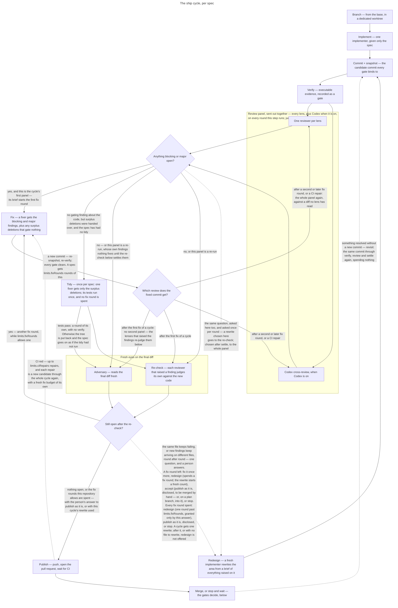
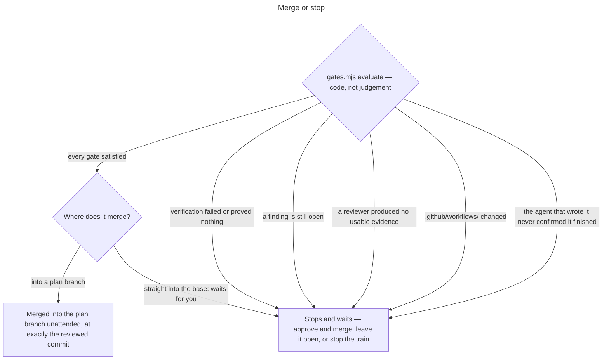

# Shipping

What `/tagteam:ship` does with each spec, from the branch to the merge, what stops a
spec and what lets a person approve past a stop, and how a whole plan ships as
one. It is for someone who wants to know why a ship did what it did; the
[README](../README.md#shipping) has the short version.

Per spec, in dependency order: branch, implement, verify, review, fix, re-check,
publish, merge — with the fix and the review repeating for as many rounds as you
allow. A driver script sequences every step and prints every dispatch; each spec
runs as one Claude Code workflow run, `tagteam:ship-spec`, which runs the driver,
dispatches what it prints and records the agents as they report. The session you
started it in starts the run, goes quiet until the run finishes, and talks to you.
Progress is in Claude Code's own workflow view: the phases, each agent under its
name, and every line the driver says, worded as the driver wrote it. A run ends
with the spec merged, with a stop and its reason, or with a question for you; you
answer in the session, and a new run carries on from your answer.

Before the first spec begins, the ship audits the dependencies of the repository
root: pnpm, npm, yarn, uv and pip, from their lockfiles, in the ship's worktree.
Patch and minor fixes are made without asking and go through the full cycle as one
pull request of their own, with every verify command run whatever its `when`; no
spec begins until it has merged. A major, a minor of a `0.x` package, a version
the ship cannot class and a package with no fixed version are never touched
without you: the ship stops, names each one, and takes your approval or decline
package by package, remembering a decline for the repository. An upgrade that
makes verify fail, cannot be made, or moves another package past a minor is left
out and listed under Risk. The check runs once per ship, never again after a spec
has begun, and changes no version of your project.

The review panel is the spec's lenses, plus a Codex cross-review when the
repository uses Codex, sent out together to run at the same time. As each one
reports you see one line saying who is in and how many of the panel have reported
("The correctness reviewer is in (1 of 3)"), and the review is judged once, when
the last one is in; a reviewer still working is never mistaken for one that
failed. With Codex off the panel is the lenses alone, nothing waits on Codex and
no spec stops because Codex did not answer. With it on, Codex is told which
lenses are reading beside it and hunts for what falls between them. After a fix
round, each reviewer that raised a finding re-checks its own findings against
the new code, and an adversary reads the fixed diff fresh. Anything still open
starts another round, for as many rounds as `limits.fixRounds` allows; when they
run out the pull request stops with the findings on it and says so. The one way
past that limit without raising it is a person's answer to the question below,
once per cycle.

The rounds also watch for two patterns no single round can see. One is the same
file drawing a new blocking or major finding three or more rounds running, each
repair opening the next case. The other is new blocking or major findings
arriving in each of the last three rounds of the cycle, on a different file each
time — or on the pull request, or on no file at all. A spec that is converging
never shows the second: a quiet round breaks the run. When either happens the
run stops to ask, and when both do it asks once, naming each file once. While a
fix round is still left there are four answers: fix it once more; redesign — a
fresh implementer rewrites the files from a brief of everything raised on them
this cycle, spending a fix round, and the rewrite starts a fresh count for each
file it changes; accept — publish it as it is with what is open disclosed, which
on a plan branch merges the spec into the plan branch with nobody asked when
everything open may be carried there (what is open is then listed in the plan's
pull request), and otherwise leaves it waiting to be merged by hand; or stop. A
redesign covers the files both patterns name; when
the findings are only about the pull request or name no file, there is nothing
to rewrite, and redesign is not offered.

When every fix round is spent, the run asks before it publishes, with three
answers: redesign, which takes one more round past `limits.fixRounds` that only
this answer grants; publish it as it is, with what is open disclosed, to be
merged by hand; or stop. The question is put once per round: answered at the
review, the re-check that follows does not ask again unless it raises something
the person was not shown.

A cycle gets one rewrite, whether it is chosen with rounds left or at the cap,
and whether or not it changes anything. After it, the question no longer offers
redesign, and once the fix rounds are spent the run publishes with what is open
disclosed without asking, and says so. A rewrite at the cap that still fails is
published the same way, for a person to merge by hand. A CI repair starts a new
cycle, and the new cycle gets a rewrite of its own.

After every fixer you see a table of what it was handed: each finding's
severity, file and title, what the fixer said it did, whether the re-check found
it addressed, and a recommendation worked out by code rather than by a model —
re-plan, needs a person, carry, or accept. Whatever is not addressed in a spec's
last table is described under Risk in its pull request.

When a fixer is sent for something blocking or major, it is also handed the
minor and nit deletions the economy reviewer asked for, if the repository uses
the economy brief this plugin ships. It may make them or decline them: they
never gate, never spend a fix round and never stop the spec, and a run says
which were made and which were not. They appear in the table but are not
described under Risk.

When a panel round hands over such deletions and nothing about the code is
blocking or major, one fixer is sent for them alone, once per spec, before the
adversary's fresh pass; the spec's tests must have passed on the commit it starts
from. The tests run on what the fixer left. If they pass, the result is a round of
its own, marked as the tidy, which spends no fix round and is not verified again;
if they fail, the fixer changed nothing or its report cannot be used, the tree is
put back exactly as it was and the spec goes on as if the tidy had not run. If the
fresh pass then raises something blocking or major on what the tidy changed, the
tidy is thrown away and the earlier commit is re-checked again with its own
verify and report as they were.

Reviewers cannot run anything, so the minor findings they file about the code are
suspicions. At a spec's first panel, the ones from correctness, from Codex when it is
on, and code-quality's that say a test would still pass with the behaviour broken, are
handed once to the adversary, which runs each and answers reproduced, with the
command and what it saw, or not reproduced. Only a reproduction makes a finding
major: it then goes to the fixer with that evidence and opens a fix round, which
spends one of the spec's fix rounds. A finding the adversary does not answer
properly stays minor, and nothing stops for it. The run lists each finding and
what became of it. Later panels are not tried, and the adversary's fresh pass
after the fix is sent as before.

The fixer reads the spec and the plan's goal as well as the findings, and can
answer that the right repair would go against the goal because the spec
conflicts with it. That stops the spec at once: no further fixer is sent, the
table recommends re-planning, and the stop says how many fix rounds were spent,
which are not given back.

Publishing waits for CI, for up to `ciWaitSec` once the checks have started.
Right after a pull request opens GitHub shows no checks on it yet, so when the
branch has workflows that run on pull requests, `publish` first waits up to
`ciStartWaitSec` — two minutes unless you set it, 0 to not wait — for checks to
appear, and stops for you if none do. A repository with no such workflows gets
no extra wait. Checks still running when `ciWaitSec` runs out are waited on
rather than given up on, and the run says how long they have been waited for;
telling it to finish the spec is how you end the wait, and the spec then stops
for you as for checks that proved nothing — or, when a check had already
failed, as for checks that failed.

A single failure does not stop a spec on its own. A verify command that fails is
run once more on the same commit, and so is the verify run against a base that
moved; failed GitHub Actions checks are rerun once before a repair is offered.
What fails again stops or goes to repair as before. What passes the second time
is said under Risk in the spec's pull request, and the spec does not merge until
the pull request says it.

A verify command that fails both of its runs is then run once on the commit the
change started from, after the repository's worktree setup has run on that base
so that the command meets the base's own install. If it fails there too, it says nothing about the change.
On a plan branch every command that fails like that is listed under Risk, in the
spec's pull request and in the plan's, as failing with and without the change,
and the spec merges: a new failure inside that command would not be noticed. The
whole-plan check and the landing checks accept such a command only if it fails on
their own base as well. A spec that merges straight into the base still stops,
and no approval merges it; the command has to be put right on the base itself.
A command that passes on the base, or whose base could not be set up, is the
change's failure and stops the spec as before.

Where a spec merges decides whether it waits for you. A spec that merges
straight into the base — a plan of one spec, or any plan with `planBranch` off —
waits for your approval every time: that is the approval every change reaching
the base needs, not a sign that anything went wrong. A spec on a plan branch
([*Shipping a plan as one*](#shipping-a-plan-as-one), below) merges into it unattended once every gate is
satisfied, because the plan's own pull request is where you judge the combined
change. On either route, a pull request also stops when verification failed (or,
straight to the base, failed on the base too) or
CI proved nothing or never started, a finding is still open, **a reviewer
produced no usable evidence**, `.github/workflows/` changed, or the agent that
wrote it never confirmed it finished what it was given. A workflow change does
not stop a spec on a plan branch when the plan's approval named every workflow
file it changed for that spec. A file the approval did not name still stops it,
and the stop names that file; a spec going straight to the base stops whatever
was approved.

On a plan branch that last stop can clear without you. Every reader of the
change rules on each thing the agent said it left undone: something the spec
still needs, something the agent could not do where it ran, or something this
change does not owe. One the readers say the spec still needs goes back for a
fix like any other finding. When all of them are the other two kinds, and the
review, verify and checks are clean, the spec merges into the plan branch and
its pull request names what was left under Risk. A commit made by hand,
with no agent to ask for a report, still waits, and so does everything that
merges straight into the base. An agent that leaves a report the run cannot use
is sent back for it once, and a person decides if that fails too.

An open finding can stop being a stop on a plan branch too, if you turn
carrying on (`carry` in `.tagteam/config.json`; it is off by default). Then a
spec whose fix rounds have run out merges into the plan branch anyway: each open
finding goes into the plan's ledger and under Risk in the spec's pull request and
in the plan's, where you judge it. A finding about the pull request's text or the
commit history, which no fixer can change, does not wait for carrying: on a plan
branch it is disclosed the same way and the spec merges, carrying on or off, as
long as it is not blocking, and it does not count toward the cap. Carrying is never used for a blocking finding, for
a whole-plan fix, for a major finding in the code of a spec that another spec
still to merge depends on, or for anything that goes straight to the base. When
carrying one more spec would take the plan past `limits.carried`, the run stops
and asks you instead.

`mergeWithOpenFindings` (`.tagteam/config.json`; off unless you turn it on, and
only on a plan branch) goes further: a spec whose fix rounds have run out merges
into the plan branch with what is open disclosed, whatever `carry` says, and nobody
is asked about it. That includes a major finding in code another spec still to
merge depends on, so only `limits.carried` and the plan's final pull request, which
you confirm, stand between those findings and the base. A blocking finding, a
whole-plan fix, a spec that goes straight to the base and anything other than its
review still stop it, and reaching `limits.carried` stops and asks you as it does
with carrying.

The missing evidence matters more than it sounds: an absent or malformed findings
file yields an empty finding set, and an empty finding set otherwise reads as a
clean review.

A person can approve past some of those stops and not others. Merging straight
into the base, a workflow change the plan's approval did not name, and an
unconfirmed account are theirs to accept; a failed verification, an open finding, and a reviewer that produced no
usable evidence are cleared only by new evidence, and `finish` offers approval
only when it would count.

## Running a ship as workflows

- In auto mode, Claude Code asks once per workflow name the first time
  `tagteam:ship-spec` or `tagteam:plan-specs` is launched, and remembers the answer.
- Recommended: set `subagentPromptCacheTtl` to `"1h"` in your own Claude Code
  settings. `/tagteam:configure` does not write it.
- Known exposure, when Codex is on: a Codex review makes the run wait in a shell
  call of up to ten minutes with no output. Claude Code was seen to let a call stay
  silent for eight minutes, and nothing longer has been tried, so whether a run
  survives the last two minutes is not known. A run that is cut short ends as a
  stop, and starting the ship again reads what is on disk and carries on.
- The configured per-role efforts, and an escalation's raised ones, reach the
  agents inside a run exactly as they reach an agent sent from the session: a
  per-call effort applies inside a workflow and overrides an agent file's. The one
  thing that beats it is `CLAUDE_CODE_EFFORT_LEVEL` in your environment, which
  overrides every effort, an escalated fixer's included.

## Shipping a plan as one

A plan shipped as one goes on the familiar feature branch: the branch one feature
— here, one plan — is collected on before it reaches the base through a single
pull request. Tagteam calls it the plan branch. What is particular to it is that
tagteam creates it and deletes it for you, and checks the combined change once
before that final pull request.

Without `planBranch`, every spec of a plan merges straight into the base branch,
and each waits for your approval before it does. Turn on `planBranch` in
`/tagteam:configure` and a plan of two or more specs ships as one instead, and
the wait for your approval moves to the plan's own pull request:

- Its specs collect on a branch of their own, `plan/<slug>`. Each is still its
  own pull request, into that branch, reviewed and gated exactly as above, and
  merged into it without asking you once every gate is satisfied. Nothing from
  the plan reaches the base until the end.
- Before each spec starts, the base is tried against the plan's branch. When it
  no longer merges cleanly, an agent resolves that one merge, the review panel
  reads what it resolved, and the ship pushes the merge commit itself. The plan's
  branch is never rebased.
- After the last spec, the whole plan is checked as one change: every verify
  command, and one reviewer reading how the specs fit together. What it finds is
  fixed as one more small pull request into the plan's branch. The same reviewer
  also looks again at every finding in the plan's ledger, the ones specs merged
  with still open, and says of each whether it is fixed, still wrong in the
  code, or needs you. When the check is otherwise clean, findings still wrong
  in the code become follow-up pull requests into the plan's branch, findings
  that touch the same files sharing one, up to `limits.followUps`. Everything
  else is listed in the plan's own pull request with where it ended up. None of
  this changes whether the check is clean or whether Merge is offered.
- Then the plan reaches the base through one final pull request, merged with a
  merge commit at exactly the commit that was checked, so each spec keeps its own
  commit in the base's history. **A person confirms that merge every time**, and
  no setting stands in for them: you are shown what lands, the plan's checks, the
  check against the base as it is now, and what the plan lands as, and you
  answer Merge, Leave open, or Stop. Merge is offered only when nothing shown
  fails. Leaving it open ends the run, and `/tagteam:ship` on the plan brings the
  same question back. That pull request's checks get the same `ciStartWaitSec`
  to appear as a spec's, when the plan's branch has workflows that run on pull
  requests; if none appears, the question says CI never started, and the next
  run waits for them again.

The repository has to allow merge commits into the base, and its checks have to
run on pull requests into the plan's branch; the ship says so plainly when
either is not the case, and changing it is a repository setting for you. When
your git signs commits, the commits the ship makes on the plan's branch itself
are signed with your own git signing setup. A base that requires signed commits
needs signing turned on in git on the machine that ships: when it is off, the
ship stops when it starts, and again before it lands the plan, with nothing
created or pushed, and says how to turn it on.

On such a base, the plan's branch can still hold commits GitHub does not show as
verified — pushed before signing was set up, or from another machine — and
GitHub refuses a merge commit for a branch that holds them. The question then
names each of them and does not offer Merge. When they are all that stands in
the way and the repository allows squash merges into the base, it offers
**Squash** instead: the plan lands as one squash commit of the checked commit,
which GitHub signs. What you give up is the history — each spec's own commit no
longer stays separate on the base. Squash is only ever your answer; the ship
never picks it for you. When a squash is not allowed either, the question says
what you can do: allow squash merges for the base, remove the signature
requirement, or re-sign those commits and merge the pull request on GitHub
yourself.

**The version.** List the lines that carry your version in `versionFiles` —
configure proposes them — and a plan of two or more specs carries exactly one
increase of them: a patch, unless the plan document says `Version increase:
minor` under its title. The ship makes it itself, as the last commit on the
plan's branch, once the whole plan is checked, from the base's version at that
moment, and the question names it ("lands as 0.10.6 → 0.10.7"). A spec that
changes a version line on the plan's branch stops before it is published, since
the increase is the ship's. If another plan lands first, the ship notices that
the base's version moved — it compares the numbers, because two plans raising
the same number merge without any conflict — merges the base in, and makes the
increase again over it. So two plans of two or more specs that land one after
the other never land the same number. A plan of one spec goes straight to the
base, as it always did, and keeps your repository's own habit for its version:
it is outside that guarantee and can collide with a plan landing beside it. The
guarantee is one checkout's: two people confirming two plans from two machines
within seconds are guarded only by your repository's own rule that a branch be
up to date before it merges, a setting you change on GitHub. An empty
`versionFiles` makes no increase at all; emptying it mid-plan takes effect at the
next `start`, which drops the lines, the increase and any version you set, says
so, and leaves a version commit already pushed on the branch. A version line you
set yourself in commits you pushed to the plan's branch and had the ship adopt is
your decision: the plan lands as that value and the ship makes no increase on
top, until the base's version moves, when the ship stops and says so.

## What a spec cost

After each spec, `/tagteam:status` can say what it cost: tagteam reads the
session transcripts Claude Code keeps and reports the spend as input-token
equivalents, split between the orchestrating agent and the agents it dispatched.
When the repository uses Codex, a Codex line follows it with what that spec's own
Codex calls spent, in plain tokens — input, how much of it was cached, and
output — kept apart from the Claude figure because Codex is paid from a different
bill, and still there when the Claude figure could not be worked out. A Codex call
that fails keeps its spend on record too.
Each spec, and each plan at approval, also names any agent that ran at a
different effort or model than it was sent at, or whose run could not be
confirmed, as a report that never holds anything up.
